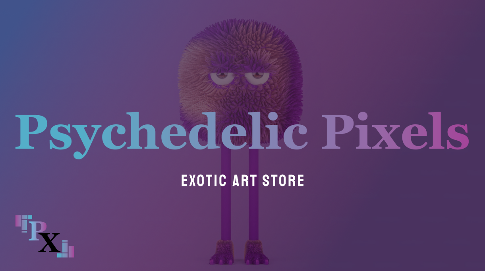
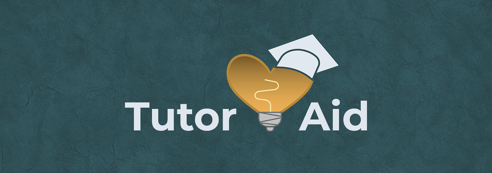

  

  

  <b>Frontend and React Native developer · UX/UI designer</b> 
  Third-year Interactive Development and UX Design student · South Africa 🇿🇦

  
  
  

---

I design and build apps end-to-end: from Figma wireframes and design systems to working React and React Native code. I care about calm, accessible interfaces and making things actually work.

## Featured projects

<table>
  <tr>
    <td width="33%" valign="top">
      
      <h3>Whelmer</h3>
      
AI focus and task companion for ADHD. Milo breaks big tasks into tiny steps; an ambient player keeps you in the zone.

      
<code>React Native</code> <code>Expo</code> <code>TypeScript</code> <code>Firebase</code> <code>Groq</code>

      <a href="https://github.com/GabyNor05/Whelmer">Repo</a> · <a href="https://youtube.com/shorts/dbEnwsnVFe0">Demo</a>
    </td>
    <td width="33%" valign="top">
      
      <h3>Get Up &amp; Go</h3>
      
Mobile app and web portal for discovering local events, managing social circles and earning Go-Points.

      
<code>React Native</code> <code>React</code> <code>Tailwind</code> <code>Firestore</code>

      <a href="https://github.com/GabyNor05/get-up-and-go">Repo</a>
    </td>
    <td width="33%" valign="top">
      
      <h3>SheIsDesign</h3>
      
Full-stack client platform for female design students: judge scoring, live leaderboard, donations. WCAG AA.

      
<code>React</code> <code>.NET</code> <code>PostgreSQL</code> <code>Electron</code>

      <a href="https://github.com/GabyNor05/SheIsDesign">Repo</a> · <a href="https://drive.google.com/file/d/1Vuk0S-6KSA4xeNBTiyUunoKhHjJYpbML/view">Demo</a>
    </td>
  </tr>
</table>

## Tools I use

  

  
<b>📁 Earlier work (2025)</b>

   
  <table>
    <tr>
      <td width="33%" valign="top">
        
        <b>Disney+ Finder</b> 
        React movie and series finder comparing ratings
      </td>
      <td width="33%" valign="top">
        
        <b>Psychedelic Pixels</b> 
        E-commerce store for surreal artwork
      </td>
      <td width="33%" valign="top">
        
        <b>Tutor Aid</b> 
        Connects students with tutors for bookings
      </td>
    </tr>
  </table>
  Full write-ups in <a href="https://github.com/GabyNor05/second-year-projects-2025">second-year-projects-2025</a>

  
<b>✨ More about me</b>

   
  
🎭 Musicals are the greatest form of entertainment (Hairspray, Wicked, Matilda, Mamma Mia) 
  ✒️ I write adventure, romance and sci-fi 
  🎲 Dungeon Master and player, Critical Role fan 
  🐾 Three cats and four dogs

--- 

## 📈 GitHub Stats  

